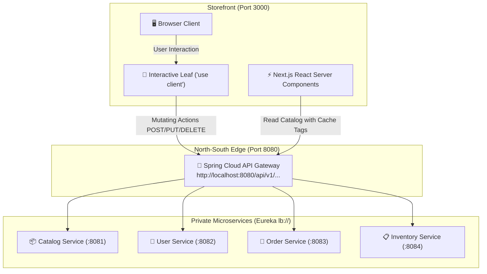

# 🛒 Front-End Engineering & Retail UI Skill

This skill enforces frontend architectural standards, the **Điện Máy Xanh** retail UI design system, Next.js App Router conventions, North-South API Gateway routing, uniform response contracts, and strict TypeScript formatting across the **eSupermarket** storefront (`frontend/`).

---

## 📌 Core Documentation & Reference Index

When building or modifying frontend components, pages, or data layers, refer to these references:
1. **Design Tokens & Geometry**: [dienmayxanh-ui-system.md](./references/dienmayxanh-ui-system.md)
2. **Gateway Communication & Contracts**: [gateway-api-client.md](./references/gateway-api-client.md)
3. **Fail-Fast Environment Validation**: [env-config.ts](./examples/env-config.ts)
4. **Typed API Client Implementation**: [api-client.ts](./examples/api-client.ts)
5. **Product Card Component**: [product-card.tsx](./examples/product-card.tsx)
6. **5-Column Product Grid Component**: [product-grid.tsx](./examples/product-grid.tsx)
7. **2-Column Product Detail Page (PDP)**: [product-detail-page.tsx](./examples/product-detail-page.tsx)
8. **Workspace Coding Standards**: [coding-standards.md](file:///C:/Projects/eSupermarket/.agent/rules/coding-standards.md)
9. **Monorepo Request Lifecycles**: [FLOW.md](file:///C:/Projects/eSupermarket/FLOW.md)

---

## 🏛️ Architecture & Traffic Flow

The frontend storefront runs on **Port 3000** and connects exclusively to the **API Gateway on Port 8080**.



> [!CAUTION]
> **Zero Direct Microservice Access:** Frontend code must NEVER directly call backend microservices on ports `8081`, `8082`, `8083`, or `8084`. All traffic routes through the API Gateway on port `8080`.

---

## 💎 The 4 Core Architectural Pillars

### 1. 🎨 Điện Máy Xanh Retail UI System

The UI system reproduces the high-converting, high-density retail design language of Điện Máy Xanh:

| Visual Element | Specification | Tailwind Implementation |
| :--- | :--- | :--- |
| **Sticky Header** | Signature electric-blue bar pinned at the top (`z-50`) | `sticky top-0 z-50 bg-[#2A83E9] text-white shadow-md` |
| **Promo Accents** | High-visibility yellow for flash sales, badges, and gifts | `bg-[#FFD400] text-gray-900 font-bold` |
| **Sale Price** | High-conversion deep red for discounted prices | `text-[#D0021B] font-extrabold text-base lg:text-lg` |
| **Original Price** | Muted strikethrough gray for pre-discount retail price | `text-[#9E9E9E] line-through text-xs` |
| **Primary CTA** | Urgent conversion orange for "MUA NGAY" (Buy Now) | `bg-[#FF6600] hover:bg-[#E65C00] text-white font-bold` |
| **5-Col Product Grid** | High-density grid maximizing screen real estate | `grid grid-cols-2 sm:grid-cols-3 md:grid-cols-4 lg:grid-cols-5 gap-2.5` |
| **Spec Attribute Chips** | Feature badges (RAM, Storage, Display, Inverter) | `bg-gray-100 text-gray-700 text-[11px] font-medium px-2 py-0.5 rounded` |
| **2-Column PDP** | Asymmetric layout: Media/specs on left, sticky purchase on right | Left: `lg:col-span-7` \| Right: `lg:col-span-5 sticky top-20` |

---

### 2. ⚡ Next.js App Router & Caching Standards

- **Directory Convention:** All routes and layouts reside strictly inside `frontend/src/app/`.
- **Server Components (RSC) by Default:** Data fetching happens on the server. Do not add `'use client'` to page components or data-fetching wrappers.
- **Push `'use client'` Down:** Only interactive leaf components (search input autocomplete, image zoom slider, variant selectors, add-to-cart buttons) may declare `'use client'`.
- **Incremental Cache Tags & ISR:** Catalog fetch requests must define explicit cache tags and revalidation timers:
  ```typescript
  const response = await fetch(`${apiGatewayUrl}/api/v1/products`, {
    next: {
      revalidate: 60,
      tags: ["products", `category-${categorySlug}`],
    },
  });
  ```
- **On-Demand Cache Invalidation:** When user mutating actions occur (e.g., checkout, stock adjustment), trigger Next.js `revalidateTag("products")` or `revalidatePath(...)`.

---

### 3. 🌐 North-South API Gateway Integration

- **Target URL:** `http://localhost:8080/api/v1/...`
- **Envelope Standard:** All microservice responses conform to the uniform `ApiResponse<T>` envelope:
  ```typescript
  export interface ApiResponse<T> {
    status: number;
    message: string;
    data: T;
  }
  ```
- **Deterministic HTTP Status Code Handling:**
  - `400 BAD_REQUEST`: Form/payload validation failure. Surface field error messages inline.
  - `401 UNAUTHORIZED`: Invalid or expired JWT token. Redirect to `/login?redirect=...`.
  - `403 FORBIDDEN`: Insufficient role (e.g. non-admin accessing admin portal). Render access denied UI.
  - `404 NOT_FOUND`: Resource missing. Call Next.js `notFound()` or display empty state.
  - `409 CONFLICT`: Duplicate entity (SKU, barcode, email). Display collision notification.
  - `500 INTERNAL_ERROR`: Internal service error. Catch with `error.tsx` boundary.
- **Auth Propagation:** Mutating calls (`POST`, `PUT`, `DELETE`) pass Bearer tokens via `Authorization: Bearer <token>`.

---

### 4. 📝 Strict Coding & Formatting Rules

- **Indentation:** Exactly **2 spaces** indentation for TypeScript, TSX, JSON, and CSS.
- **Strict Typing (Zero `any`):** Strictly no `any`. Use strict interfaces, generics, or `unknown` with runtime type narrowing.
- **Maximum Line Length:** Strictly **120 characters** per line. Break chains, arguments, and long JSX strings across lines.
- **Explicit Lambda Functions:** Strictly **no point-free or implicit method references**. Always declare explicit parameter lists and arrow functions (e.g., `(item) => item.id`, `(spec) => spec.value`).
- **Fail-Fast Environment Configuration:**
  - Prohibited: `process.env.VAR || "default"` or `${VAR:default}`.
  - Required: Throws an immediate descriptive `Error` during bootstrap if any required environment variable is missing or empty.
- **Uniform Action Prefixes:** All data fetching functions, API client methods, and server actions MUST use standard action prefixes:
  - `create...` -> `createOrder()`, `createCartItem()`, `createCustomerReview()`
  - `read...` -> `readProductBySlug()`, `readCatalogList()`, `readUserProfile()`
  - `search...` -> `searchProducts()`, `searchStoresByLocation()`
  - `update...` -> `updateCartItemQuantity()`, `updateUserProfile()`
  - `delete...` -> `deleteCartItem()`, `deleteSavedAddress()`

---

## 🛠️ Step-by-Step Developer Workflows

### Workflow 1: Creating a High-Density Product Grid Page
1. Create page at `frontend/src/app/products/page.tsx` as a Server Component.
2. Read search parameters (e.g., `category`, `page`).
3. Call `readResource<ProductCardProps[]>` using cache tags `['products', category]`.
4. Render the 5-column grid container:
   ```tsx
   <div className="grid grid-cols-2 sm:grid-cols-3 md:grid-cols-4 lg:grid-cols-5 gap-2.5">
     {products.map((product) => (
       <ProductCard key={product.id} {...product} />
     ))}
   </div>
   ```

### Workflow 2: Creating a 2-Column Product Detail Page (PDP)
1. Create dynamic route at `frontend/src/app/product/[slug]/page.tsx` as a Server Component.
2. Fetch product data using `readResource<ProductDetailData>('/api/v1/products/' + slug, ['product-' + slug], 60)`.
3. If not found or error status is 404, call `notFound()`.
4. Build the 2-column grid layout:
   - Left column (`lg:col-span-7`): Gallery image reel, feature bullet points, technical specs table.
   - Right column (`lg:col-span-5`): Sticky container (`sticky top-20`) with `#D0021B` price, `#FFD400` promo box, variant selectors, and `#FF6600` "MUA NGAY" CTA.

### Workflow 3: Wiring Interactive Client Leaf Components
1. Extract client interactivity (e.g. quantity counter, cart add button, thumbnail clicker) into a separate file in `frontend/src/components/leaves/`.
2. Add `'use client';` strictly at the very top of that leaf file.
3. Keep the parent page and layout as Server Components.

---

## ✅ Pre-Commit Verification Checklist

Before submitting frontend code, verify each item:

- [ ] **Port Routing:** All requests target API Gateway (`:8080/api/v1/...`); zero direct calls to internal ports (`8081-8084`).
- [ ] **Contract Envelope:** Response types are typed with `ApiResponse<T>` and errors handle status codes (400, 401, 403, 404, 409, 500).
- [ ] **Fail-Fast Env:** `readAppConfig()` or env assertions throw immediately on missing keys; no `|| "default"` fallbacks.
- [ ] **Brand Tokens:** Header uses `#2A83E9`, promos use `#FFD400`, prices use `#D0021B`, CTAs use `#FF6600`.
- [ ] **Grid Geometry:** Product lists use 5-column responsive density (`grid-cols-2 sm:grid-cols-3 md:grid-cols-4 lg:grid-cols-5 gap-2.5`).
- [ ] **PDP Layout:** Detail pages use 2-column layout (`col-span-7` media/specs, `col-span-5 sticky top-20` buy box).
- [ ] **Spec Chips:** Product specs are presented using compact attribute pill chips.
- [ ] **RSC by Default:** Pages and data fetching are React Server Components; `'use client'` is pushed to leaf components.
- [ ] **Caching:** Fetches include incremental cache tags (`next: { revalidate: 60, tags: [...] }`).
- [ ] **TypeScript Cleanliness:** Zero `any` types; all interfaces explicitly defined.
- [ ] **Action Prefixes:** Functions strictly prefixed with `create...`, `read...`, `search...`, `update...`, `delete...`.
- [ ] **Formatting:** 2 spaces indentation; maximum 120 characters line limit; explicit arrow lambda functions.
