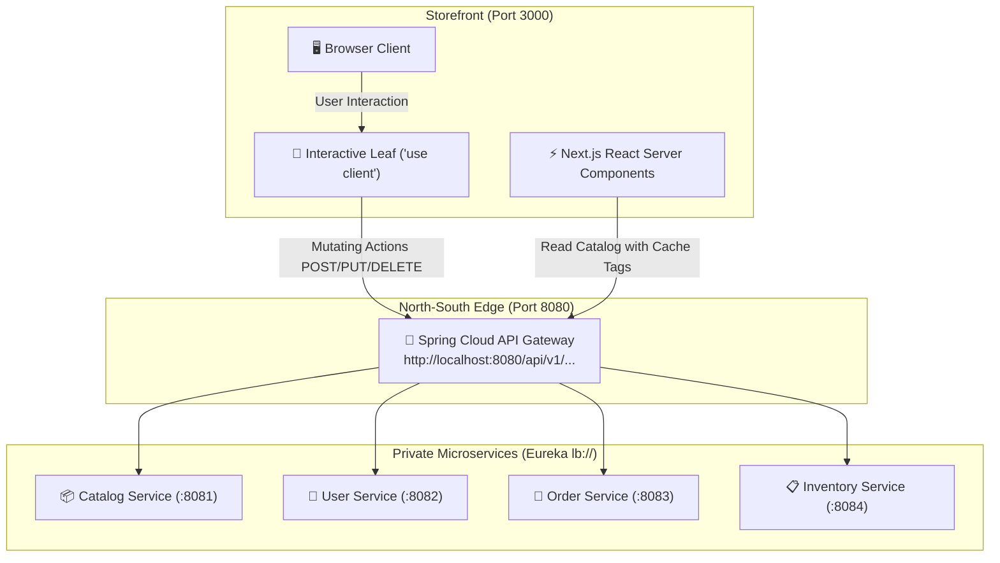

# 🛒 Front-End Engineering & Modern White/Brown E-Commerce Skill

This skill enforces frontend architectural standards, the **Modern Minimalist White & Brown** e-commerce design system, **English UI copy with VND (`₫`) currency**, Next.js App Router conventions, North-South API Gateway routing, uniform response contracts, and strict TypeScript formatting across the **eSupermarket** storefront (`frontend/`).

---

## 📌 Core Documentation & Reference Index

When building or modifying frontend components, pages, or data layers, refer to these references:
1. **Design Tokens & Geometry**: [minimalUiSystem.md](./references/minimalUiSystem.md)
2. **Gateway Communication & Contracts**: [gateway-api-client.md](./references/gateway-api-client.md)
3. **Fail-Fast Environment Validation**: [envConfig.ts](./examples/envConfig.ts)
4. **Typed API Client Implementation**: [apiClient.ts](./examples/apiClient.ts)
5. **Product Card Component**: [ProductCard.tsx](./examples/ProductCard.tsx)
6. **4-Column Product Grid Component**: [ProductGrid.tsx](./examples/ProductGrid.tsx)
7. **2-Column Product Detail Page (PDP)**: [ProductDetailPage.tsx](./examples/ProductDetailPage.tsx)
8. **Workspace Coding Standards**: [coding-standards.md](../../rules/coding-standards.md)
9. **Backend Inter-Module Flows**: [FLOW.md](../../../document/FLOW.md)
10. **End-to-End Page Flows & Skill**: [document/README.md](../../../document/README.md) & [flow-documentation](../flow-documentation/SKILL.md)

---

## 🏛️ Architecture & Traffic Flow

The frontend storefront runs on **Port 3000** and connects exclusively to the **API Gateway on Port 8080**.



> [!CAUTION]
> **Zero Direct Microservice Access:** Frontend code must NEVER directly call backend microservices on ports `8081`, `8082`, `8083`, or `8084`. All traffic routes through the API Gateway on port `8080`.

---

## 💎 The 4 Core Architectural Pillars

### 1. 🎨 Modern Minimalist White & Brown UI System (English UI + VND Currency)

The UI system follows a calm, editorial e-commerce aesthetic inspired by modern Dribbble and UI Store Design templates:

| Visual Element | Specification | Tailwind Implementation |
| :--- | :--- | :--- |
| **Airy White Header** | Minimalist `#3E2723` top strip + crisp white underline nav | `bg-white/95 backdrop-blur border-b border-[#EAE3DB]` |
| **Editorial Hero** | Warm alabaster split banner + serif headline + pill CTA | `bg-[#FAF8F5] border border-[#EAE3DB]` + `font-serif` |
| **Espresso Primary CTA** | Sleek rounded-full espresso button (`Shop Collection`, `Sign In`) | `rounded-full bg-[#3E2723] hover:bg-[#5C4033] text-white` |
| **VND Price** | Refined espresso price formatting (`10.490.000 ₫`) | `text-base font-semibold text-[#3E2723] tracking-tight` |
| **Chestnut & Sand Accents** | Warm chestnut brand labels + soft sand tag pills | `text-[#8B5E3C]` + `bg-[#F5F1EC] text-[#5C4033]` |
| **4-Col Gallery Grid** | Open gallery grid with generous spacing (`gap-x-6 gap-y-10`) | `grid grid-cols-1 sm:grid-cols-2 lg:grid-cols-4 gap-x-6 gap-y-10` |
| **Image Stage** | Warm alabaster square frame with soft floating badges | `rounded-2xl bg-[#FAF8F5] border border-[#EFEAE4]` |
| **Spec Attribute Chips** | Minimalist sandstone pill chips for product attributes | `rounded-full bg-[#F5F1EC] px-2.5 py-0.5 text-[11px] text-[#5C4033]` |
| **2-Column PDP** | Asymmetric layout: Gallery/specs on left, details on right | Left: `lg:col-span-7` \| Right: `lg:col-span-5` |
| **Language & Currency** | All storefront labels/messages in **English**; prices in **VND (`₫`)** | `<html lang="en">` + `Intl.NumberFormat("vi-VN", { style: "currency", currency: "VND" })` |

---

### 2. ⚡ Next.js App Router & Caching Standards

- **Directory & Route Convention:** All routes reside strictly inside `frontend/src/app/`. Route entry points must strictly be named `page.tsx` (never `index.page.ts` or `index.tsx`).
- **Component Colocation via Private Folders (`_components`):** Single-use child components for a specific route must be colocated in `src/app/<route>/_components/<ComponentName>.tsx`. Shared components across routes reside in `src/components/` (e.g., `src/components/ProductCard.tsx`).
- **Descriptive File Naming (PascalCase & camelCase Only — No kebab-case):**
  - Every React component file must use a descriptive **PascalCase** filename matching the component identifier (e.g., `LoginForm.tsx`, `ProductCard.tsx`, `StoreHeader.tsx`).
  - Every non-component TypeScript module (config, services, utils, hooks, types) must use **camelCase** (e.g., `envConfig.ts`, `authService.ts`, `apiClient.ts`, `formatters.ts`).
  - Keep Next.js App Router reserved filenames (`page.tsx`, `layout.tsx`, `loading.tsx`, `error.tsx`, `not-found.tsx`, `globals.css`) and `_components` colocation folders.
  - **Prohibited:** `kebab-case` code filenames (`env-config.ts`, `auth-service.ts`, `product-card.tsx`) and generic `index.tsx` or `index.ts` files.
- **Server Components (RSC) by Default:** Data fetching happens on the server. Do not add `'use client'` to page components or data-fetching wrappers.
- **Push `'use client'` Down:** Only interactive leaf components (account header actions, quick-view modals, variant selectors, forms) may declare `'use client'`.
- **Incremental Cache Tags & ISR:** Catalog fetch requests must define explicit cache tags and revalidation timers:
  ```typescript
  const response = await fetch(`${apiGatewayUrl}/api/v1/products`, {
    next: {
      revalidate: 60,
      tags: ["products", `category-${categoryId}`],
    },
  });
  ```
- **On-Demand Cache Invalidation:** When user mutating actions occur (e.g., checkout, stock adjustment), trigger Next.js `revalidateTag("products")` or `revalidatePath(...)`.

---

### 3. 🌐 North-South API Gateway Integration

- **Target URL:** `http://localhost:8080/api/v1/...`
- **Envelope Standard:** All microservice responses conform to the uniform `ApiResponse<T>` envelope:
  ```typescript
  export interface ApiResponse<T> {
    timestamp?: string;
    status: number;
    message: string;
    data: T | null;
  }
  ```
- **Deterministic HTTP Status Code Handling & Safe Response Conversion:**
  - Read `await httpResponse.text()` and convert JSON payloads via `convertApiResponse<T>()` so non-JSON `503`/`502`/`404` Gateway responses still surface their real HTTP status code instead of misreporting as network failures.
  - `400 BAD_REQUEST`: Form/payload validation failure. Surface plain English field error messages inline.
  - `401 UNAUTHORIZED`: Invalid credentials or expired JWT token. Display plain error or redirect to `/login?redirect=...`.
  - `403 FORBIDDEN`: Insufficient role. Render access denied UI.
  - `404 NOT_FOUND`: Resource missing. Call Next.js `notFound()` or display empty state.
  - `409 CONFLICT`: Duplicate entity (SKU, barcode, email). Display plain collision notification.
  - `500 INTERNAL_ERROR`: Internal service error. Catch with `error.tsx` boundary.
- **Auth Propagation & Storage:**
  - Client auth tokens (`accessToken`, `refreshToken`, user profile) are stored in browser `localStorage` (not cookies).
  - Mutating calls (`POST`, `PUT`, `DELETE`) pass Bearer tokens via `Authorization: Bearer <token>`.

---

### 4. 📝 Strict Coding & Formatting Rules

- **Pure Functions Only (Zero Classes):** Modern frontend strictly uses functional components, hooks, and standalone exported functions. Do not use ES6/TypeScript `class` structures or custom `class ... extends Error`.
- **Direct Response Pattern (No "Result" Word):** Do not create artificial `Result` or `Either` types. Always return and handle the uniform `ApiResponse<T>` contract named `response` (`{ status, message, data }`).
- **Indentation & Line Endings:** Exactly **2 spaces** indentation (`tabWidth: 2`) and LF line endings (`endOfLine: "lf"`) for TypeScript, TSX, JSON, and CSS.
- **Strict Typing (Zero `any`):** Strictly no `any`. Use strict interfaces, generics, or `unknown` with runtime type narrowing.
- **Maximum Line Length (100 Characters):** Strictly **100 characters** per line across frontend TypeScript, TSX, comments, and strings, enforced by Prettier (`printWidth: 100`) and ESLint (`max-len` error rule).
- **Tailwind `className` Formatting (Inline Multi-Line Strings):**
  - Always place Tailwind classes directly inside `className="..."` (or template literal `` className={`...`} `` for conditional/dynamic classes) on the JSX tag so IDE Tailwind CSS autocomplete and hover popups work natively.
  - Do **NOT** extract Tailwind class strings into helper functions (`joinClassNames`, `cn`) or top-of-file style constants.
  - Whenever a `className` attribute would push a line past 100 characters, break it cleanly across multiple lines with Enter inside the quotes/backticks so every line stays `<= 100` characters:
    ```tsx
    <input
      id="email"
      type="email"
      className="w-full px-4 py-2.5 text-sm bg-[#FAF8F5]
        border border-[#E5DDD3] rounded-xl text-[#1F1916] placeholder-[#94877C]
        focus:outline-none focus:bg-white focus:border-[#5C4033]
        focus:ring-1 focus:ring-[#5C4033] transition-colors"
    />
    ```
- **Plain Error Messages (No Bracket Prefixes):**
  - Write plain, direct English error messages (e.g., `` `Missing required environment variable: "${key}". Check your .env.local file.` ``).
  - **Strictly Prohibited:** Bracketed tag prefixes in error messages such as `[FAIL-FAST CONFIG ERROR]`, `[ERROR]`, or `[XXX] ...`.
- **Explicit Lambda Functions:** Strictly **no point-free or implicit method references**. Always declare explicit parameter lists and arrow functions (e.g., `(item) => item.id`, `(spec) => spec.attrValue`).
- **Fail-Fast Environment Configuration:**
  - Prohibited: `process.env.VAR || "default"`, `${VAR:default}`, or dynamic `process.env[key]` in client-reachable config (Next.js Webpack does not inline dynamic `process.env[key]` in `"use client"` bundles).
  - Required: Pass static `process.env.NEXT_PUBLIC_*` reads into a fail-fast assertion that throws an immediate plain descriptive `Error` if missing or empty.
- **Uniform Action Prefixes:** All data fetching functions, API client methods, and server actions MUST use standard action prefixes:
  - `create...` -> `createAuthLogin()`, `createOrder()`, `createCartItem()`
  - `read...` -> `readProducts()`, `readCategories()`, `readBrands()`, `readUserProfile()`
  - `search...` -> `searchProducts()`, `searchStoresByLocation()`
  - `update...` -> `updateCartItemQuantity()`, `updateUserProfile()`
  - `delete...` -> `deleteCartItem()`, `deleteAuthTokens()`
  - `convert...` -> `convertApiResponse()`, `convertProductPayload()` *(strictly use `convert...` instead of `parse...` for response or data conversion helpers)*

---

## 🛠️ Step-by-Step Developer Workflows

### Workflow 1: Creating a Modern 4-Column Gallery Product Grid
1. Create Server Component page at `frontend/src/app/page.tsx`.
2. Read search parameters (`q`, `category`, `brand`, `tag`, `group`).
3. Call `readProducts()` or `searchProducts(query)` from `@/services/catalogService` with cache tags.
4. Render the 4-column grid container:
   ```tsx
   <div
     className="grid grid-cols-1 sm:grid-cols-2 lg:grid-cols-4
       gap-x-6 gap-y-10"
   >
     {products.map((product) => (
       <ProductCard key={product.id} product={product} />
     ))}
   </div>
   ```

### Workflow 2: Creating a 2-Column Product Detail Page (PDP)
1. Create dynamic route at `frontend/src/app/products/[id]/page.tsx` as a Server Component.
2. Fetch product data using `readGatewayResource<ProductResponse>` with cache tags and `60`-second revalidation.
3. If not found or status is 404, call `notFound()`.
4. Build the 2-column grid layout:
   - Left column (`lg:col-span-7`): Gallery image reel on `#FAF8F5` backdrop and technical specifications table (`attributes`).
   - Right column (`lg:col-span-5`): Sticky container (`sticky top-24`) with `#3E2723` VND price, `#F5F1EC` highlights, SKU/barcode/supplier info, and `#3E2723` pill CTA.

### Workflow 3: Wiring Interactive Client Leaf Components
1. Extract client interactivity (e.g., quick-view modal, header session check, form handlers) into a dedicated PascalCase component.
2. Add `"use client";` strictly at the very top of that leaf file.
3. Keep the parent page and layout as Server Components.

---

## ✅ Pre-Commit Verification Checklist

Before submitting frontend code, verify each item:

- [ ] **Port Routing:** All requests target API Gateway (`:8080/api/v1/...`); zero direct calls to internal ports (`8081-8084`).
- [ ] **Contract Envelope:** Response types are typed with `ApiResponse<T>` and safely convert non-JSON error responses via `convertApiResponse<T>()`.
- [ ] **Fail-Fast Env:** `readAppConfig()` throws immediately on missing keys; no `|| "default"` fallbacks.
- [ ] **Brand Tokens:** Surfaces use `#FFFFFF` / `#FAF8F5` / `#F5F1EC`, primary actions & VND prices use `#3E2723` / `#5C4033`, accents use `#8B5E3C`, borders use `#EAE3DB`.
- [ ] **Language & Currency:** All storefront UI copy and error messages are in **English**; prices format in **VND (`₫`)**.
- [ ] **Grid Geometry:** Product lists use 4-column gallery grid (`grid-cols-1 sm:grid-cols-2 lg:grid-cols-4 gap-x-6 gap-y-10`).
- [ ] **PDP Layout:** Detail pages use 2-column layout (`col-span-7` media/specs, `col-span-5` details/buy box).
- [ ] **Spec Chips:** Product specs use sandstone pill chips (`bg-[#F5F1EC] text-[#5C4033]`).
- [ ] **RSC by Default:** Pages and data fetching are React Server Components; `"use client"` is pushed to leaf components.
- [ ] **Route Entry Points:** Route entry points are strictly named `page.tsx` (no `index.page.ts`).
- [ ] **Descriptive File Names:** Components use **PascalCase** (`LoginForm.tsx`) and non-component TS modules use **camelCase** (`envConfig.ts`, `authService.ts`, `formatters.ts`); `kebab-case` code files and generic `index.tsx`/`index.ts` are prohibited.
- [ ] **Route Colocation:** Single-use child components are colocated in `src/app/<route>/_components/` (or `src/app/_components/`).
- [ ] **Caching:** Fetches include incremental cache tags (`next: { revalidate: 60, tags: [...] }`).
- [ ] **TypeScript Cleanliness:** Zero `any` types; all interfaces explicitly defined.
- [ ] **Action Prefixes:** Functions strictly prefixed with `create...`, `read...`, `search...`, `update...`, `delete...`, `convert...` (never `parse...`).
- [ ] **Pure Functional (Zero Classes):** Strictly no classes in frontend code; pure functions, hooks, and interfaces only.
- [ ] **Direct Response Pattern:** Uses direct `ApiResponse<T>` named `response`; no `Result` wrapper abstractions.
- [ ] **Plain Error Messages:** Error messages use plain English text without `[XXX]` bracket prefixes.
- [ ] **Token Storage:** JWT tokens are stored and retrieved from browser `localStorage` (not cookies).
- [ ] **Formatting & `className` Readability:** 2 spaces indentation, LF line endings, max **100 characters** per line (Prettier + ESLint `max-len`), explicit arrow lambdas, and inline multi-line `className="..."` (or `` className={`...`} `` for dynamic states) directly on JSX tags without helper functions.
