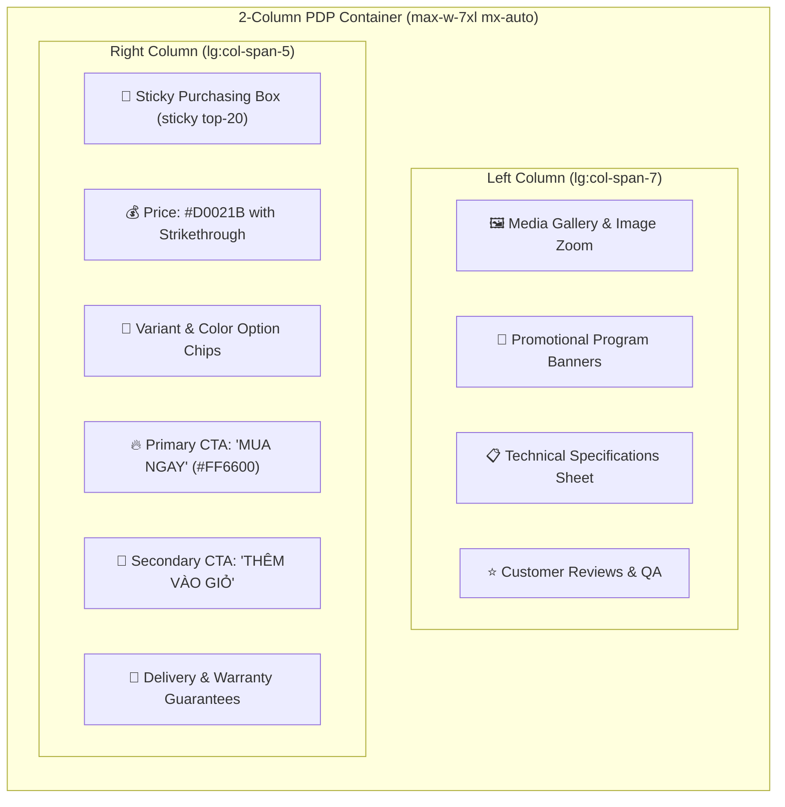

# 🎨 Điện Máy Xanh Retail UI Design System Reference

This document defines the visual specification, color tokens, typography, grid geometry, and layout components for the **Điện Máy Xanh** e-commerce retail storefront.

---

## 1. 🎨 Primary Color Palette & Token Hierarchy

The Điện Máy Xanh retail identity relies on a high-energy, conversion-optimized color hierarchy designed for mass consumer electronics and retail supermarkets.

| Color Name | Hex Code | Tailwind Custom Utility | Semantic Role & UI Placement |
| :--- | :--- | :--- | :--- |
| **Electric Blue** | `#2A83E9` | `bg-[#2A83E9]`, `text-[#2A83E9]` | Signature brand header, sticky navigation, active category filters, primary brand trust badges. |
| **Promo Yellow** | `#FFD400` | `bg-[#FFD400]`, `text-[#FFD400]` | High-voltage promotional highlights, flash sale countdown bars, gift badges, rating stars, alert chips. |
| **Conversion Red** | `#D0021B` | `text-[#D0021B]`, `bg-[#D0021B]` | Final sale prices, discount tags (`-15%`), urgency banners, deal highlights. |
| **Conversion Orange** | `#FF6600` | `bg-[#FF6600]`, `hover:bg-[#E65C00]` | Primary CTA button ("MUA NGAY" / "Buy Now"), instant order triggers, flash deal timers. |
| **Original Price Gray** | `#9E9E9E` | `text-[#9E9E9E] line-through` | Strikethrough pre-discount retail price. |
| **Surface Background** | `#F3F4F6` | `bg-gray-100` / `bg-[#F3F4F6]` | General page background, category section wrapper, pill chip backgrounds. |
| **Card White** | `#FFFFFF` | `bg-white` | Product cards, sticky sidebars, specification tables, modal sheets. |
| **Text Primary** | `#333333` | `text-[#333333]` / `text-gray-900` | Product titles, primary labels, specifications key names. |

```css
/* Color token definition for frontend/tailwind.config.ts extension */
colors: {
  dmx: {
    blue: "#2A83E9",
    yellow: "#FFD400",
    red: "#D0021B",
    orange: "#FF6600",
    gray: "#9E9E9E",
    surface: "#F3F4F6"
  }
}
```

---

## 2. 🏷️ Sticky Electric-Blue Header Anatomy

The top header is pinned (`sticky top-0 z-50`) and spans the full viewport width with the signature `#2A83E9` background:

- **Height:** 64px (`h-16`) on desktop, compact 56px (`h-14`) on mobile.
- **Left Section:** Logo and location/store selector chip (`bg-white/20 hover:bg-white/30 text-white rounded-full`).
- **Center Section:** Omnichannel search bar with white background, subtle rounded edges (`rounded-md`), search icon, and quick keyword tags.
- **Right Section:** Quick action links:
  - "Giỏ hàng" (Cart with numeric yellow badge `#FFD400` with black text).
  - "Lịch sử đơn hàng" (Order tracking).
  - "Hỏi đáp / Tư vấn" (Support).

---

## 3. 📦 5-Column High-Density Product Grid

The catalogue layout uses a high-density 5-column grid on desktop screens to maximize product discoverability per scroll depth:

```html
<div className="grid grid-cols-2 sm:grid-cols-3 md:grid-cols-4 lg:grid-cols-5 gap-2.5">
  <!-- Product Cards -->
</div>
```

### Product Card Anatomy & Dimensions
- **Padding:** 12px (`p-3`).
- **Border & Background:** White background (`bg-white`), 1px solid gray border (`border border-gray-200 hover:border-[#2A83E9]`), subtle rounded corners (`rounded-lg`).
- **Elevation:** Transition on hover (`transition-all duration-200 hover:shadow-lg hover:-translate-y-0.5`).
- **Product Image:** Aspect ratio 1:1 (`aspect-square`), object-contain, clean white backdrop.
- **Promo Badge (Top Left of Card):** Yellow pill (`bg-[#FFD400] text-gray-900 text-[11px] font-bold px-2 py-0.5 rounded`).
- **Product Title:** 2-line clamp (`line-clamp-2 text-sm font-medium text-gray-800 hover:text-[#2A83E9]`).
- **Spec Attribute Chips:** High-density specification row immediately below the title.
- **Price Hierarchy:**
  - **Sale Price:** Large bold red font (`text-[#D0021B] text-base font-bold`).
  - **Strikethrough Price:** Small muted gray (`text-[#9E9E9E] text-xs line-through`).
  - **Discount Percent:** Red rounded tag (`text-[#D0021B] text-xs bg-red-50 px-1.5 py-0.5 rounded font-semibold`).
- **Promotion Gifts / Installment:** Note tag (e.g. `Trả góp 0%`, `Tặng phiếu mua hàng`).
- **Action CTA:** Orange action button (`bg-[#FF6600] hover:bg-[#E65C00] text-white text-xs font-semibold py-1.5 px-3 rounded w-full`).

---

## 4. 🏷️ Spec Attribute Chips

Spec chips display critical buying criteria at a glance (e.g., RAM, Storage, Screen, Inverter, Capacity, Refresh Rate):

```tsx
<div className="flex flex-wrap gap-1 my-2">
  <span className="inline-block bg-gray-100 text-gray-700 text-[11px] font-medium px-2 py-0.5 rounded">
    RAM 8 GB
  </span>
  <span className="inline-block bg-gray-100 text-gray-700 text-[11px] font-medium px-2 py-0.5 rounded">
    SSD 512 GB
  </span>
  <span className="inline-block bg-gray-100 text-gray-700 text-[11px] font-medium px-2 py-0.5 rounded">
    120 Hz
  </span>
</div>
```

---

## 5. 📄 2-Column Product Detail Page (PDP) Layout

The Product Detail Page splits into an asymmetric 2-column layout on desktop:



### Left Column (`lg:col-span-7`): Media & Specifications
1. **Interactive Gallery:** High-resolution main image with zoom viewer, accompanied by a thumbnail reel below.
2. **Key Selling Points:** Highlighted bullet points with checkmark icons.
3. **Full Technical Specifications Table:** Clean alternating table (`bg-gray-50` and `bg-white`) listing technical parameters (Dimensions, Power, Origin, Warranty, Hardware specs).

### Right Column (`lg:col-span-5`): Sticky Purchase Hub
1. **Product Name & Rating:** H1 heading, star rating (`text-[#FFD400]`), review count, and SKU code.
2. **Pricing Section:**
   - Giant conversion red price (`text-[#D0021B] text-2xl font-extrabold`).
   - Original price strikethrough with discount pill tag.
3. **Yellow Incentive Callout:** Promo box bordered in `#FFD400` with gift icons and instant discounts.
4. **Variant Selector:** Interactive radio chips for colors, storage, or package options.
5. **Call-To-Action Hierarchy:**
   - **Primary CTA:** Full-width `#FF6600` orange button: **"MUA NGAY (Giao tận nơi hoặc nhận tại cửa hàng)"**.
   - **Secondary Row:** Split buttons for **"TRẢ GÓP 0% (Duyệt hồ sơ qua điện thoại)"** and **"THÊM VÀO GIỎ HÀNG"**.
6. **Policy Badges:** 1-to-1 replacement within 30 days, 100% genuine warranty, fast 2-hour delivery.
