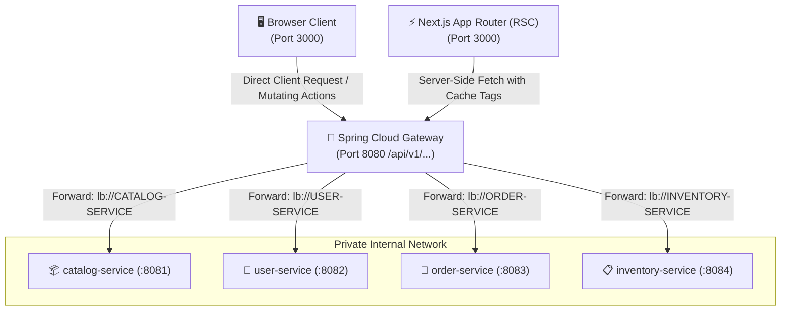

# 🌐 North-South API Gateway Integration & Contracts Reference

This document defines the communication contract between the Next.js Storefront (`http://localhost:3000`) and the Spring Cloud API Gateway (`http://localhost:8080/api/v1/...`).

---

## 1. 🚪 Edge Routing & Topology

All frontend data requests MUST enter through the API Gateway on port `8080`. Frontend code must NEVER call internal microservice ports (`8081`, `8082`, `8083`, `8084`) directly.



---

## 2. 📦 Uniform Response Envelope: `ApiResponse<T>`

Every REST endpoint routed through the Gateway returns data wrapped in the uniform `ApiResponse<T>` envelope:

```typescript
export interface ApiResponse<T> {
  status: number;
  message: string;
  data: T;
}
```

### JSON Response Example
```json
{
  "status": 200,
  "message": "Product retrieved successfully",
  "data": {
    "id": 101,
    "sku": "TIVI-SONY-55X80L",
    "name": "Google Tivi Sony 4K 55 inch KD-55X80L",
    "regularPrice": 16900000,
    "salePrice": 14490000,
    "stockQuantity": 25,
    "specs": [
      { "key": "Screen", "value": "55 inch 4K" },
      { "key": "RefreshRate", "value": "60 Hz" }
    ]
  }
}
```

---

## 3. 🚨 HTTP Status Code Mapping Matrix

The frontend API client must explicitly translate backend response statuses into deterministic client behaviors:

| HTTP Status | Spring Boot Exception Source | Meaning & Scenario | Frontend Handling Strategy |
| :--- | :--- | :--- | :--- |
| **`200 OK` / `201 CREATED`** | Success | Request succeeded. | Unwrap and return `response.data`. |
| **`400 BAD_REQUEST`** | `MethodArgumentNotValidException`, `IllegalArgumentException` | Form validation failure, malformed payload. | Extract error messages and display inline on form fields. |
| **`401 UNAUTHORIZED`** | `UnauthorizedException` | Missing, malformed, or expired JWT token. | Clear auth token state; redirect user to `/login?redirect=...`. |
| **`403 FORBIDDEN`** | `AccessDeniedException` | Insufficient RBAC roles (e.g. non-admin accessing admin portal). | Display access denied screen or redirect to home with flash message. |
| **`404 NOT_FOUND`** | `ResourceNotFoundException` | Resource ID / slug does not exist. | In RSC: call Next.js `notFound()`. In client: display 404 empty state. |
| **`409 CONFLICT`** | `DuplicateResourceException` | Uniqueness violation (SKU, barcode, email already exists). | Display descriptive collision alert to user without crash. |
| **`500 INTERNAL_ERROR`** | `Exception` | Unhandled backend failure. | Catch in Next.js `error.tsx` boundary; log error and display fallback. |

---

## 4. ⚡ Next.js App Router Caching & Revalidation Tags

Server Components (RSC) must leverage Next.js incremental cache tags with `fetch()`:

```typescript
// Pattern for catalog data with 60-second ISR and cache tags
export const readProducts = async (categorySlug?: string): Promise<Product[]> => {
  const endpoint = categorySlug
    ? `${getGatewayUrl()}/api/v1/products?category=${categorySlug}`
    : `${getGatewayUrl()}/api/v1/products`;

  const response = await fetch(endpoint, {
    method: "GET",
    headers: {
      "Content-Type": "application/json",
    },
    next: {
      revalidate: 60,
      tags: ["products", ...(categorySlug ? [`category-${categorySlug}`] : [])],
    },
  });

  if (!response.ok) {
    throw await parseApiError(response);
  }

  const envelope: ApiResponse<Product[]> = await response.json();
  return envelope.data;
};
```

---

## 5. 🏷️ Standard Action Method Prefixes

All API client methods and Server Actions must use standard action prefixes:

- `create...` -> `createOrder`, `createCartItem`, `createReview`
- `read...` -> `readProducts`, `readProductBySlug`, `readUserSession`
- `search...` -> `searchCatalog`, `searchProductsByKeywords`
- `update...` -> `updateCartItemQuantity`, `updateUserProfile`
- `delete...` -> `deleteCartItem`, `deleteOrderDraft`
