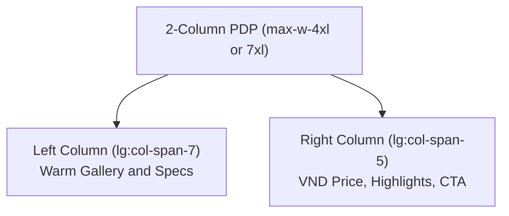

# 🎨 Modern Minimalist White & Brown E-Commerce UI Reference

This document defines the visual specification, color tokens, typography, gallery grid geometry, and layout components for the **eSupermarket** storefront—inspired by modern minimalist white-and-brown editorial e-commerce templates (Dribbble / UI Store Design), using **English UI copy** with **VND (`₫`) pricing**.

---

## 1. 🎨 Primary Color Palette & Token Hierarchy

The aesthetic centers on pure white breathing room, warm alabaster image stages, and rich roasted espresso/chestnut brown accents:

| Color Name | Hex Code | Tailwind Custom Utility | Semantic Role & UI Placement |
| :--- | :--- | :--- | :--- |
| **Pure Canvas White** | `#FFFFFF` | `bg-white` | Main page canvas, sticky minimalist header, editorial modals, elevated login card. |
| **Warm Alabaster** | `#FAF8F5` | `bg-[#FAF8F5]` | Image stage backdrop, split hero surface, filter chips, form inputs, footer surface. |
| **Sandstone Wash** | `#F5F1EC` | `bg-[#F5F1EC]` | Attribute chips, subtle collection badges, secondary surface blocks. |
| **Espresso Brown** | `#3E2723` | `bg-[#3E2723]`, `text-[#3E2723]` | Primary buttons, VND price text, top announcement bar, active underline/filter pills. |
| **Cocoa Brown** | `#5C4033` | `hover:bg-[#5C4033]`, `text-[#5C4033]` | Primary button hover states, input focus borders, secondary titles. |
| **Warm Chestnut** | `#8B5E3C` | `text-[#8B5E3C]`, `border-[#8B5E3C]` | Brand labels, editorial kickers, subtle hover borders, tag highlights. |
| **Warm Hairline** | `#EAE3DB` | `border-[#EAE3DB]` | Subtle dividers, card borders, gallery frames. |
| **Charcoal Ink** | `#1F1916` | `text-[#1F1916]` | Primary headings, product names, navigation items. |
| **Muted Taupe** | `#6E6259` | `text-[#6E6259]` | Subtitles, secondary descriptions, specifications keys. |

```css
/* Color token definition in frontend/tailwind.config.ts */
colors: {
  brand: {
    espresso: "#3E2723",
    cocoa: "#5C4033",
    chestnut: "#8B5E3C",
    sand: "#F5F1EC",
    alabaster: "#FAF8F5",
    border: "#EAE3DB",
    ink: "#1F1916",
    muted: "#6E6259"
  }
}
```

---

## 2. 🏷️ Airy White Header & Editorial Navigation

1. **Subtle Top Strip (`bg-[#3E2723]`):** Thin tracked uppercase announcement (`Curated Quality Essentials • Complimentary Same-Day Delivery`).
2. **Main White Header (`bg-white/95 backdrop-blur border-b border-[#EAE3DB]`):**
   - Left: Minimalist `e` circular espresso monogram + serif `eSupermarket` wordmark.
   - Right: Pill-shaped warm alabaster search input (`rounded-full bg-[#FAF8F5]`) + `Sign In` / `Sign Out` pill action.
3. **Editorial Underline Department Strip:** Clean horizontal links (`All Products` + root categories) with thin `border-b-2 border-[#3E2723]` active state instead of boxed buttons.

---

## 3. 🖼️ Editorial Hero & 4-Column Gallery Grid

- **Split Editorial Hero:** Left column features generous padding (`p-8 sm:p-14`), serif headline (`font-serif`), warm taupe copy, and pill CTAs (`bg-[#3E2723] rounded-full`). Right column showcases featured products on a `#F2ECE4` warm panel.
- **Gallery Product Grid (`gap-x-6 gap-y-10`):**

```tsx
<div
  className="grid grid-cols-1 sm:grid-cols-2 lg:grid-cols-4
    gap-x-6 gap-y-10"
>
  {/* Gallery Product Cards */}
</div>
```

### Gallery Product Card Anatomy
- **No heavy outer card box:** Clean open layout where only the image stage (`aspect-square rounded-2xl bg-[#FAF8F5] border border-[#EFEAE4]`) frames the photo.
- **Floating Micro-Badges:** Subtle rounded-full pills inside the top corners (`bg-white/95 text-[#3E2723]` for primary tag, `bg-[#F2ECE4]/95 text-[#5C4033]` for package size).
- **Editorial Copy Stack:** Uppercase chestnut brand label (`text-[#8B5E3C]`), 2-line product title (`text-[#1F1916]`), up to 2 warm sand attribute pills (`bg-[#F5F1EC] text-[#5C4033]`).
- **Footer Row:** Clean VND price in espresso (`text-base font-semibold text-[#3E2723]`) alongside a pill-shaped `"Quick View"` outline action (`rounded-full border border-[#D8CFC4] hover:bg-[#3E2723] hover:text-white`).

---

## 4. 🏷️ Spec Attribute Chips

Keep Tailwind classes inline on `className="..."` and wrap with Enter so every line stays under 100 characters:

```tsx
<div className="flex flex-wrap gap-1.5 pt-0.5">
  <span
    className="rounded-full bg-[#F5F1EC] px-2.5 py-0.5
      text-[11px] text-[#5C4033]"
  >
    8 GB RAM
  </span>
  <span
    className="rounded-full bg-[#F5F1EC] px-2.5 py-0.5
      text-[11px] text-[#5C4033]"
  >
    512 GB SSD
  </span>
</div>
```

---

## 5. 📄 Split Product Lightbox / Detail Page (PDP)


