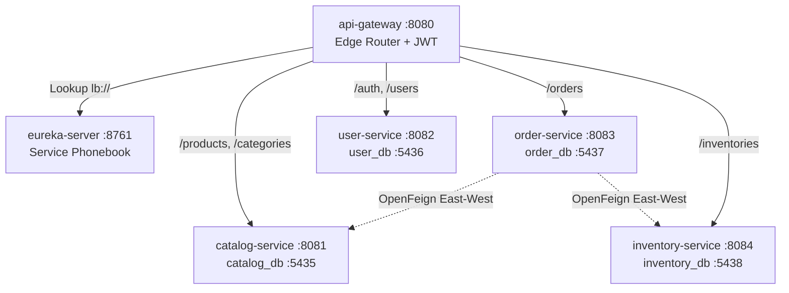
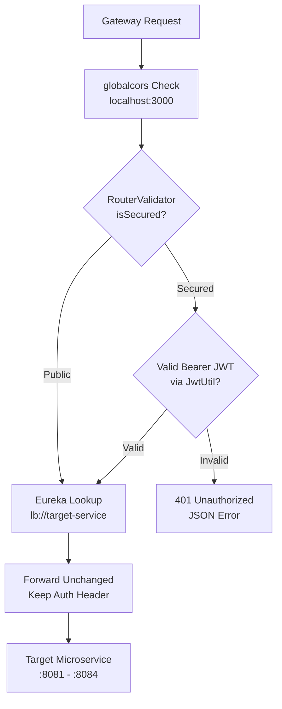

# 🔄 Backend Inter-Module Communication & Architecture (`FLOW.md`)

This document describes **general backend architecture and service-to-service communication** across the **eSupermarket** Spring Boot microservices.

For browser-to-database page walkthroughs (Next.js frontend through backend), see [document/README.md](./README.md) and [document/flows/](./flows/).

---

## 1. 🗺️ Backend Topology & Port Map

Every backend module runs as an independent Spring Boot process with its own responsibility and isolated PostgreSQL database:

```text
┌────────────────────────────────────────────────────────┐
│ EUREKA SERVER (:8761) - Service Registry               │
│ Tracks live IPs/ports for all backend modules          │
└────────▲─────────────▲─────────────▲─────────────▲─────┘
         │ Register    │ Register    │ Register    │ Register
┌────────┴─────────────┴─────────────┴─────────────┴─────┐
│ API GATEWAY (:8080) - Spring Cloud Gateway (Netty)     │
│ RouterValidator + AuthenticationFilter + lb:// routing │
└───┬──────────────┬───────────────┬──────────────┬──────┘
    │ lb://        │ lb://         │ lb://        │ lb://
    ▼              ▼               ▼              ▼
┌────────┐    ┌─────────┐    ┌──────────┐   ┌───────────┐
│Catalog │    │User     │    │Order     │   │Inventory  │
│(:8081) │    │(:8082)  │    │(:8083)   │   │(:8084)    │
└───┬────┘    └────┬────┘    └────┬─────┘   └─────┬─────┘
    │              │              │               │
    ▼              ▼              ▼               ▼
┌────────┐    ┌─────────┐    ┌──────────┐   ┌───────────┐
│catalog_│    │user_db  │    │order_db  │   │inventory_ │
│db :5435│    │:5436    │    │:5437     │   │db :5438   │
└────────┘    └─────────┘    └──────────┘   └───────────┘
```



| Module | Port | Database (`postgres:16-alpine`) | Primary Role |
| :--- | :--- | :--- | :--- |
| **`eureka-server`** | `8761` | *None* | Service registry (`register-with-eureka: false`, `fetch-registry: false`) |
| **`api-gateway`** | `8080` | *None* | Reactive Netty edge router, CORS, stateless JWT gate, `lb://` dispatch |
| **`catalog-service`** | `8081` | `catalog_db` (`:5435`, `ddl-auto: validate`) | Products, categories, brands, suppliers, tags, product groups |
| **`user-service`** | `8082` | `user_db` (`:5436`, `ddl-auto: update`) | Auth, BCrypt passwords, JWT issuance, refresh tokens, user profiles |
| **`order-service`** | `8083` | `order_db` (`:5437`, `ddl-auto: update`) | Cash / COD checkout, order tracking, admin revenue analytics |
| **`inventory-service`** | `8084` | `inventory_db` (`:5438`, `ddl-auto: update`) | Warehouse stock levels, deductions, safety thresholds, stock summary |

---

## 2. 🧭 Service Discovery (`eureka-server` :8761)

Think of **Eureka Server** (`EurekaServerApplication`) as the live service phonebook:

1. **Startup Registration:** Each microservice (`catalog-service`, `user-service`, `order-service`, `inventory-service`, `api-gateway`) configures `eureka.client.service-url.defaultZone: http://localhost:8761/eureka/` with `eureka.instance.prefer-ip-address: true`.
2. **Periodic Heartbeats:** Every registered service sends regular heartbeats to Eureka to remain `UP`.
3. **Client-Side Load Balancing (`lb://`):** `api-gateway` and internal Spring Cloud OpenFeign clients pull the registry list from Eureka and resolve logical names (`lb://user-service`, `lb://catalog-service`, etc.) to concrete host/port instances at runtime.

---

## 3. 🚪 Gateway Routing & Stateless Auth (`api-gateway` :8080)

Inside `api-gateway`, every incoming request passes through `AuthenticationFilter` (`GlobalFilter`, `Ordered` priority `-1`) before reactive routing:



### Route Dispatch Table (`api-gateway/src/main/resources/application.yaml`)
* `/api/v1/products/**`, `/api/v1/categories/**`, `/api/v1/brands/**`, `/api/v1/suppliers/**`, `/api/v1/tags/**`, `/api/v1/product-groups/**` → `lb://catalog-service`
* `/api/v1/auth/**`, `/api/v1/users/**` → `lb://user-service`
* `/api/v1/orders/**` → `lb://order-service`
* `/api/v1/inventories/**` → `lb://inventory-service`

### Gateway Public vs Secured Rules (`RouterValidator`)
* **Always Public (`OPEN_API_ENDPOINTS`):** `/api/v1/auth/register`, `/api/v1/auth/login`, `/api/v1/auth/refresh-token`, `/actuator`, `/v3/api-docs`, `/swagger-ui`.
* **Public `GET` Only (`PUBLIC_GET_PREFIXES`):** `/api/v1/products`, `/api/v1/categories`, `/api/v1/brands`, `/api/v1/suppliers`, `/api/v1/tags`, `/api/v1/product-groups`.
* **Secured (JWT Required):** Every other route and all `POST` / `PUT` / `DELETE` / `PATCH` calls outside `OPEN_API_ENDPOINTS`.

---

## 4. 🔐 Cross-Service Cryptographic Trust (Shared JWT Verification)

Backend modules verify user identity and RBAC roles **without calling `user-service` over the network on every request**:

1. **Issuance (`user-service`):** `JwtUtil.generateAccessToken(User)` signs HS256 JWTs containing `subject` (UUID), `email`, `fullName`, and `roles` (`ROLE_ADMIN`, `ROLE_CUSTOMER`).
2. **Deterministic Key Derivation:** `api-gateway`, `user-service`, `order-service`, and `inventory-service` all configure the same `application.jwt.secret` and run `JwtUtil.deriveSigningKey(secret)` (`MessageDigest.getInstance("SHA-256")` → 256-bit HMAC key).
3. **Header Preservation:** `api-gateway` validates the token signature and expiry at the edge, then forwards the **original `Authorization: Bearer <token>` header unchanged** (`chain.filter(exchange)`).
4. **Downstream RBAC:** Services like `order-service` and `inventory-service` read the forwarded `Authorization` header directly via their local `JwtUtil` to enforce `ROLE_ADMIN` or extract `userId`.

---

## 5. 🔗 East-West Inter-Service Communication (`OpenFeign`)

When backend microservices need data from another domain, they communicate **directly inside the private network** using **Spring Cloud OpenFeign** + **Eureka**—bypassing `api-gateway` to avoid double network hops.

### Current Implementation Status in Codebase
* **Provisioned Dependencies:** `spring-cloud-starter-openfeign` (`4.2.0`) is included across the backend modules, and `@EnableFeignClients` is enabled on `InventoryServiceApplication`.
* **Active Wiring Status:** Currently, `order-service` (`OrderServiceImpl`) receives item snapshot fields directly inside `CreateOrderRequest` without active `@FeignClient` interfaces yet. When cross-service checkout price lookup (`order-service` → `catalog-service`) and stock deduction (`order-service` → `inventory-service`) are wired, they will execute via `@FeignClient(name = "catalog-service")` and `@FeignClient(name = "inventory-service")` using Eureka discovery.

---

## 6. 🗄️ Database-per-Service Isolation

* Each domain microservice owns an exclusive PostgreSQL 16 database defined in `database\docker-compose.yml` (lines 3–85):
  * `catalog-service` (`:8081`) ↔ `catalog_db` (`:5435`)
  * `user-service` (`:8082`) ↔ `user_db` (`:5436`)
  * `order-service` (`:8083`) ↔ `order_db` (`:5437`)
  * `inventory-service` (`:8084`) ↔ `inventory_db` (`:5438`)
* **Rule:** Services never connect to another service's database or perform cross-database SQL joins. Cross-domain data must always be exchanged through service APIs or request snapshots.
