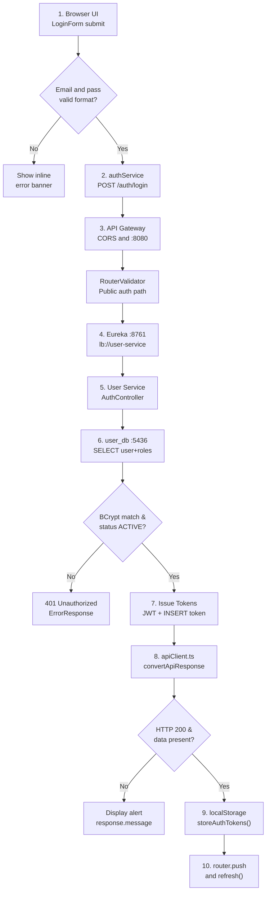

# 🔐 Login Flow Documentation (`/login`)

Complete end-to-end request lifecycle for user authentication from the browser through Next.js, API Gateway, Eureka, User Service, and PostgreSQL.

| Attribute | Value |
| :--- | :--- |
| **Route URL** | `/login` (supports `?redirect=/...` query param) |
| **Page Entry (RSC)** | `frontend/src/app/login/page.tsx` (`LoginPage`) |
| **Interactive Leaf** | `frontend/src/app/login/_components/LoginForm.tsx` (`LoginForm`) |
| **Frontend Services** | `createAuthLogin`, `storeAuthTokens` (`authService.ts`), `convertApiResponse` (`apiClient.ts`) |
| **Gateway Edge** | `POST http://localhost:8080/api/v1/auth/login` (`OPEN_API_ENDPOINTS`, public) |
| **Microservice** | `user-service` (`:8082`) — `AuthController` → `AuthServiceImpl` → `JwtUtil` |
| **Database** | PostgreSQL `user_db` (`:5436`) — `users`, `user_roles`, `refresh_tokens` |

---

## 1. 📊 Visual End-to-End Flow

### Terminal-Safe Overview (Unicode Box Art)

```text
┌────────────────────────────────────────────────────────┐
│ 1. BROWSER & NEXT.JS FE (:3000)                        │
│    LoginForm validates email/password & calls          │
│    createAuthLogin() -> readAppConfig() (:8080)        │
└───────────────────────────┬────────────────────────────┘
                            │ OPTIONS + POST /auth/login
                            ▼
┌────────────────────────────────────────────────────────┐
│ 2. API GATEWAY (:8080) & EUREKA (:8761)                │
│    CORS allows :3000 | RouterValidator: OPEN endpoint  │
│    Resolve lb://user-service via Eureka -> :8082       │
└───────────────────────────┬────────────────────────────┘
                            │ Forward POST JSON
                            ▼
┌────────────────────────────────────────────────────────┐
│ 3. USER SERVICE (:8082)                                │
│    AuthController (@Valid LoginRequest)                │
│    AuthServiceImpl: BCrypt verify + ACTIVE check       │
└───────────────────────────┬────────────────────────────┘
                            │ JPA / JDBC (:5436)
                            ▼
┌────────────────────────────────────────────────────────┐
│ 4. POSTGRESQL user_db (:5436)                          │
│    SELECT users + user_roles (EAGER)                   │
│    INSERT refresh_tokens (7-day opaque token)          │
└───────────────────────────┬────────────────────────────┘
                            │ 200 OK ApiResponse JSON
                            ▼
┌────────────────────────────────────────────────────────┐
│ 5. RESPONSE -> FE STORAGE -> REDIRECT                  │
│    JwtUtil signs HS256 JWT (24h) -> AuthResponse       │
│    convertApiResponse() -> storeAuthTokens()           │
│    localStorage saved -> router.push(destination)      │
└────────────────────────────────────────────────────────┘
```

### Interactive Diagram (Mermaid `flowchart TD`)



---

## 2. 🔍 Deep Layer-by-Layer Execution Trace

### Stage 1: Browser & Next.js Frontend (`localhost:3000`)
1. **Header Entry Point:** `frontend\src\components\StoreHeader.tsx` (lines 63–65) renders `"use client"` `frontend\src\components\HeaderAccountActions.tsx` (lines 9–55). On mount (`useEffect`, lines 13–19), it checks `readAuthToken()` and `readAuthUserProfile()`. When absent, it renders a `Sign In` link to `/login`.
2. **Route & Form Component:** `frontend\src\app\login\page.tsx` (lines 16–69, Server Component) reads `searchParams.redirect || "/"` and renders `<LoginForm redirectUrl={redirectUrl} />`.
3. **Client Validation:** In `frontend\src\app\login\_components\LoginForm.tsx` (lines 20–58), `handleSubmit(e)`:
   - Prevents default browser form submission (`e.preventDefault()`) and clears `errorMessage`.
   - Checks non-empty `email.trim()` and `password.trim()` (lines 24–27).
   - Validates `email.trim()` against `/^[^\s@]+@[^\s@]+\.[^\s@]+$/` (lines 29–33).
   - Sets `isLoading = true` and calls `createAuthLogin({ email: email.trim(), password })` (lines 35–41).
4. **Fail-Fast Env & HTTP Call:** `createAuthLogin` in `frontend\src\services\authService.ts` (lines 9–32) calls `readAppConfig()` in `frontend\src\config\envConfig.ts` (lines 23–30), which statically reads `process.env.NEXT_PUBLIC_API_GATEWAY_URL` (`http://localhost:8080` in `frontend\.env.local`, line 1) and throws immediately if missing. It then executes `fetch("http://localhost:8080/api/v1/auth/login", { method: "POST", headers: { "Content-Type": "application/json" }, body: JSON.stringify(payload) })`.
5. **Browser Preflight (`OPTIONS`):** Because the request goes cross-origin from `:3000` to `:8080` with `Content-Type: application/json`, the browser sends an HTTP `OPTIONS` preflight before the `POST`.

### Stage 2: API Gateway (`:8080`) & Eureka (`:8761`)
1. **CORS Check:** `globalcors` in `backend\api-gateway\src\main\resources\application.yaml` (lines 44–60) permits `http://localhost:3000` and `http://127.0.0.1:3000` (`GET`, `POST`, `PUT`, `DELETE`, `OPTIONS`, `PATCH`, `allowed-headers: "*"`, `allow-credentials: true`, `max-age: 3600`).
2. **Public Route Bypass:** `backend\api-gateway\src\main\java\com\coding\api\gateway\filter\AuthenticationFilter.java` (lines 36–42, `Ordered -1`) invokes `routerValidator.isSecured.test(request)` in `backend\api-gateway\src\main\java\com\coding\api\gateway\validator\RouterValidator.java` (lines 14–50). Because `/api/v1/auth/login` matches `OPEN_API_ENDPOINTS` (line 16), `isSecured` returns `false`, skipping JWT header checks.
3. **Eureka Load-Balanced Routing:** Gateway matches route `id: user-service` (`Path=/api/v1/auth/**, /api/v1/users/**`, lines 23–26 of `application.yaml`), resolves `uri: lb://user-service` via Eureka (`http://localhost:8761/eureka/`, lines 81–84), and forwards `POST /api/v1/auth/login` to `user-service` (`:8082`).

### Stage 3: User Service (`:8082`)
1. **Bean Validation:** `backend\user-service\src\main\java\com\coding\controller\AuthController.java` (lines 42–53) receives `@Valid @RequestBody LoginRequest` from `backend\user-service\src\main\java\com\coding\dto\request\LoginRequest.java` (lines 16–25: `@NotBlank` + `@Email` on `email`, `@NotBlank` on `password`). Validation failures return `400 BAD_REQUEST` via `backend\user-service\src\main\java\com\coding\exception\GlobalExceptionHandler.java` (lines 17–36). Note that `user-service` uses `spring-security-crypto` (`BCryptPasswordEncoder` bean in `backend\user-service\src\main\java\com\coding\config\SecurityConfig.java`, lines 11–14) without a Servlet security filter chain, as JWT edge gating runs in `api-gateway`.
2. **Credential & Status Verification:** Inside `@Transactional` `backend\user-service\src\main\java\com\coding\service\impl\AuthServiceImpl.java` (lines 68–93):
   - Looks up user via `userRepository.findByEmail(request.getEmail())` (lines 69–70). Not found → `InvalidCredentialsException("Invalid email or password")`.
   - Verifies password via `passwordEncoder.matches(request.getPassword(), user.getPassword())` (lines 72–74). Mismatch → `InvalidCredentialsException("Invalid email or password")` (identical message prevents email enumeration).
   - Verifies `user.getStatus() == UserStatus.ACTIVE` (lines 76–79) using `backend\user-service\src\main\java\com\coding\model\UserStatus.java` (lines 3–7: `ACTIVE`, `INACTIVE`, `LOCKED`). Inactive/locked accounts throw `InvalidCredentialsException`.
3. **Token Issuance:**
   - `backend\user-service\src\main\java\com\coding\security\JwtUtil.java` (lines 33–71) derives a 256-bit HMAC key with `SHA-256` from `application.jwt.secret` (matching `api-gateway`) and signs an access JWT (`subject` = UUID, claims `email`, `fullName`, `roles`, expiry `86400000` ms = 24h).
   - `createRefreshToken(user)` (`AuthServiceImpl.java`, lines 129–138) generates a 64-hex-character opaque string (`generateRefreshTokenString()`), sets expiry to `604800000` ms (7 days), `revoked = false`, and persists it in `refresh_tokens`.
   - `backend\user-service\src\main\java\com\coding\mapper\UserMapper.java` (line 16) maps `User` to `UserResponse` (excluding `password`), and `AuthController` returns `200 OK` with `ApiResponse(AuthResponse)`.

### Stage 4: PostgreSQL Database (`user_db` on Port `5436`)
Schema defined in `database\migrations\user\V1__init_user_schema.sql` (lines 5–41) and seeded in `database\migrations\user\V2__seed_admin_user.sql` (lines 5–39):
1. **`users`:** Queried by `email` (unique index `idx_users_email` on `LOWER(email)`, line 17; note `UserRepository.findByEmail` performs exact match). Stores `id` (UUID), BCrypt `password` (`crypt(..., gen_salt('bf', 10))` for seeded users), `full_name`, `status`, timestamps.
2. **`user_roles`:** Loaded eagerly via `@ElementCollection(fetch = FetchType.EAGER)` on `backend\user-service\src\main\java\com\coding\model\User.java` (lines 62–66: `ROLE_ADMIN`, `ROLE_CUSTOMER`) so roles can be written into the JWT and `UserResponse`.
3. **`refresh_tokens`:** Receives an `INSERT` row (`id`, unique `token`, `user_id` FK with `ON DELETE CASCADE`, `expiry_date`, `revoked`).

### Stage 5: Return Path, Conversion & Browser Session Storage
1. **Envelope Conversion:** `createAuthLogin` passes the Fetch `Response` to `convertApiResponse<AuthResponse>(httpResponse, "Authentication request")` in `frontend\src\services\apiClient.ts` (lines 10–46), normalizing both JSON envelopes (`200`, `400`, `401`) and non-JSON gateway errors into `{ timestamp, status, message, data }`. Fetch/network errors return `{ status: 503, message, data: null }`.
2. **Persistence & Redirect:** In `frontend\src\app\login\_components\LoginForm.tsx` (lines 43–50):
   - When `response.status === 200 && response.data`, `storeAuthTokens(response.data)` (`authService.ts`, lines 37–45) writes four keys into browser `localStorage`: `"accessToken"`, `"refreshToken"`, `"tokenType"` (`"Bearer"`), and `"userProfile"` (`JSON.stringify(authData.user)`).
   - Normalizes `destination = redirectUrl.startsWith("/") ? redirectUrl : "/${redirectUrl}"` and calls `router.push(destination)` + `router.refresh()`.
   - When `frontend\src\components\HeaderAccountActions.tsx` (lines 13–44) mounts on the next page, it reads `"accessToken"` and `"userProfile"` and displays `{userProfile.fullName}` + `Sign Out`.

---

## 3. 📦 Key Contracts & Status Matrix

### `localStorage` Session Keys
| Key | Stored Value | Written By | Read / Cleared By |
| :--- | :--- | :--- | :--- |
| `accessToken` | Signed HS256 JWT string (24h) | `storeAuthTokens` | `readAuthToken`, `deleteAuthTokens` |
| `refreshToken` | 64-char opaque token string (7d) | `storeAuthTokens` | `deleteAuthTokens` |
| `tokenType` | `"Bearer"` | `storeAuthTokens` | `deleteAuthTokens` |
| `userProfile` | Serialized `UserResponse` JSON | `storeAuthTokens` | `readAuthUserProfile`, `deleteAuthTokens` |

### HTTP Status Handling Matrix
| HTTP Status | Source | Payload Shape | Frontend Behavior |
| :--- | :--- | :--- | :--- |
| `200 OK` | `AuthController.login` | `ApiResponse(AuthResponse)` | Stores session in `localStorage`, calls `router.push` & `router.refresh()` |
| `400 BAD_REQUEST` | `GlobalExceptionHandler` (`MethodArgumentNotValidException`) | `ErrorResponse` (`status: 400`, `message: "Validation failed"`, `errors`) | `convertApiResponse` preserves `status: 400`; `LoginForm` shows `response.message` |
| `401 UNAUTHORIZED` | `GlobalExceptionHandler` (`InvalidCredentialsException`) | `ErrorResponse` (`status: 401`, `message`) | `LoginForm` renders red alert banner with `response.message` |
| `503 SERVICE_UNAVAILABLE` | `createAuthLogin` `catch` block (Gateway unreachable) | `ApiResponse(null)` (`status: 503`) | `LoginForm` displays unreachable-server message without crashing |

---

## 4. 🔗 Verified Source References

| Layer | File Path & Lines | Key Symbols |
| :--- | :--- | :--- |
| **FE Route** | `frontend\src\app\login\page.tsx` (lines 16–69) | `LoginPage` |
| **FE Form** | `frontend\src\app\login\_components\LoginForm.tsx` (lines 11–58) | `LoginForm`, `handleSubmit` |
| **FE Header** | `frontend\src\components\HeaderAccountActions.tsx` (lines 9–55) | `HeaderAccountActions`, `handleLogout` |
| **FE Service** | `frontend\src\services\authService.ts` (lines 9–86) | `createAuthLogin`, `storeAuthTokens`, `readAuthToken`, `readAuthUserProfile`, `deleteAuthTokens` |
| **FE Client & Env** | `frontend\src\services\apiClient.ts` (lines 10–46), `frontend\src\config\envConfig.ts` (lines 9–30) | `convertApiResponse`, `readAppConfig` |
| **Gateway** | `backend\api-gateway\src\main\resources\application.yaml` (lines 23–84), `backend\api-gateway\src\main\java\com\coding\api\gateway\filter\AuthenticationFilter.java` (lines 36–108), `backend\api-gateway\src\main\java\com\coding\api\gateway\validator\RouterValidator.java` (lines 14–50) | `globalcors`, `AuthenticationFilter.filter`, `RouterValidator.isSecured` |
| **User Controller** | `backend\user-service\src\main\java\com\coding\controller\AuthController.java` (lines 42–53), `backend\user-service\src\main\java\com\coding\exception\GlobalExceptionHandler.java` (lines 17–78) | `login`, `handleInvalidCredentialsException`, `handleValidationExceptions` |
| **User Logic & JWT** | `backend\user-service\src\main\java\com\coding\service\impl\AuthServiceImpl.java` (lines 68–138), `backend\user-service\src\main\java\com\coding\security\JwtUtil.java` (lines 33–71), `backend\user-service\src\main\java\com\coding\config\SecurityConfig.java` (lines 11–14) | `AuthServiceImpl.login`, `createRefreshToken`, `generateAccessToken`, `deriveSigningKey`, `passwordEncoder` |
| **User DB & Entities** | `backend\user-service\src\main\java\com\coding\model\User.java` (lines 32–66), `backend\user-service\src\main\java\com\coding\model\RefreshToken.java` (lines 28–48), `database\migrations\user\V1__init_user_schema.sql` (lines 5–41) | `users`, `user_roles`, `refresh_tokens` |
