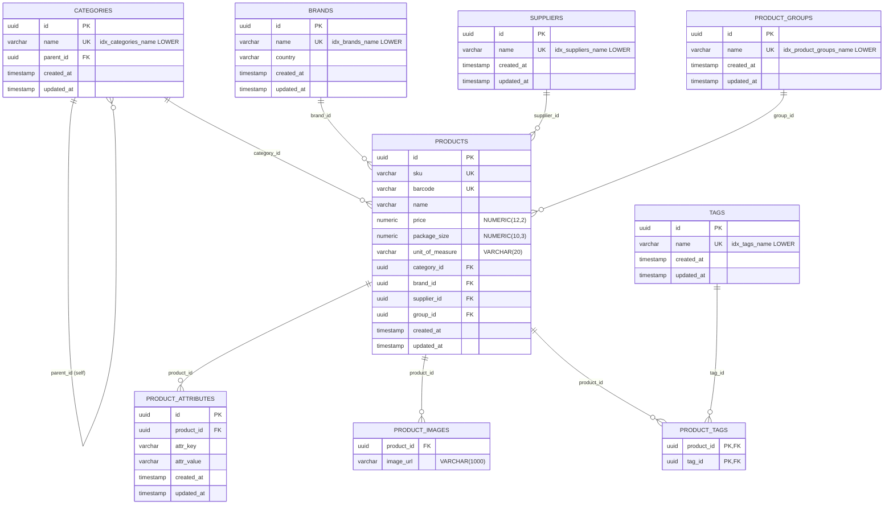

# 📦 Catalog Service Database Schema (`catalog_db`)

Database table structure, foreign keys, JPA relationships, and indexes for `catalog-service`.

| Attribute | Value |
| :--- | :--- |
| **Microservice** | `catalog-service` (`:8081`) |
| **PostgreSQL DB** | `catalog_db` (`:5435`, `spring.jpa.hibernate.ddl-auto: validate`) |
| **Flyway Migrations** | `database\migrations\catalog\V1__init_catalog_schema.sql`, `V2__seed_reference_data.sql`, `V3__seed_sample_products.sql` |
| **Table Count** | `9` tables (`BRANDS`, `CATEGORIES`, `SUPPLIERS`, `PRODUCT_GROUPS`, `TAGS`, `PRODUCTS`, `PRODUCT_TAGS`, `PRODUCT_ATTRIBUTES`, `PRODUCT_IMAGES`) |

---

## 1. 📊 Database Relationship Diagrams

### Terminal-Safe Overview (Unicode Box Art)

```text
┌────────────────────────────────────────────────────────┐
│ catalog_db (:5435) - 9 Tables (SQL FKs)                │
├────────────────────────────────────────────────────────┤
│ CATEGORIES (id PK, parent_id FK -> CATEGORIES.id)      │
│ BRANDS | SUPPLIERS | PRODUCT_GROUPS | TAGS             │
│        ▲            ▲             ▲        ▲           │
│        └────┬───────┴─────┬───────┘        │           │
│             ▼             │                │           │
│          PRODUCTS (category_id, brand_id,  │           │
│                    supplier_id, group_id)  │           │
│             ├── 1:N ──► PRODUCT_ATTRIBUTES │           │
│             ├── 1:N ──► PRODUCT_IMAGES     │           │
│             └── N:M ──► PRODUCT_TAGS ──────┘           │
└────────────────────────────────────────────────────────┘
```

### Entity-Relationship Diagram (Mermaid `erDiagram`)



---

## 2. 🔗 Intra-DB Foreign Keys, Constraints & JPA Mapping

| Source Table & Column | Target Table & Column | Cardinality | SQL `ON DELETE` | JPA / Performance Notes |
| :--- | :--- | :--- | :--- | :--- |
| `CATEGORIES.parent_id` | `CATEGORIES.id` | `N:1` (self-ref) | `SET NULL` | `@ManyToOne(fetch = LAZY)` in `Category.java` |
| `PRODUCTS.category_id` | `CATEGORIES.id` | `N:1` | `SET NULL` | `@ManyToOne(fetch = LAZY)` in `Product.java` |
| `PRODUCTS.brand_id` | `BRANDS.id` | `N:1` | `SET NULL` | `@ManyToOne(fetch = LAZY)` in `Product.java` |
| `PRODUCTS.supplier_id` | `SUPPLIERS.id` | `N:1` | `SET NULL` | `@ManyToOne(fetch = LAZY)` in `Product.java` |
| `PRODUCTS.group_id` | `PRODUCT_GROUPS.id` | `N:1` | `SET NULL` | `@ManyToOne(fetch = LAZY)` in `Product.java` |
| `PRODUCT_TAGS.product_id` | `PRODUCTS.id` | `N:M` join | `CASCADE` | `@ManyToMany(fetch = LAZY)` + `@BatchSize(size = 25)` |
| `PRODUCT_TAGS.tag_id` | `TAGS.id` | `N:M` join | `CASCADE` | Composite PK `(product_id, tag_id)` |
| `PRODUCT_ATTRIBUTES.product_id` | `PRODUCTS.id` | `1:N` | `CASCADE` | `@OneToMany` + `@BatchSize(size = 25)` + `orphanRemoval = true` |
| `PRODUCT_IMAGES.product_id` | `PRODUCTS.id` | `1:N` | `CASCADE` | `@ElementCollection` + `@BatchSize(size = 25)` |

### Cross-Service Logical References (No SQL Foreign Keys)
* `catalog_db` holds **no** outgoing references to other microservices.
* Downstream services (`order_db.order_items.product_id` / `product_sku`, `inventory_db.inventories.product_id` / `product_sku`) reference `PRODUCTS.id` and `PRODUCTS.sku` logically by UUID/SKU across service boundaries.

### Unique & Secondary Indexes
* Case-insensitive unique indexes on `LOWER(name)`: `idx_brands_name`, `idx_categories_name`, `idx_suppliers_name`, `idx_product_groups_name`, `idx_tags_name`.
* Unique constraints on `PRODUCTS`: `uq_products_sku` (`sku`), `uq_products_barcode` (`barcode`).
* Foreign key lookup indexes: `idx_categories_parent_id`, `idx_products_category_id`, `idx_products_brand_id`, `idx_products_supplier_id`, `idx_products_group_id`, `idx_product_tags_tag_id`, `idx_product_attributes_product_id`, `idx_product_images_product_id`.

---

## 3. 🔗 Verified Source References

* `database\migrations\catalog\V1__init_catalog_schema.sql` (lines 1–109) — DDL for all 9 tables, foreign keys, and indexes.
* `backend\catalog-service\src\main\resources\application.yaml` (lines 8–22) — `catalog_db` datasource (`:5435`) and `ddl-auto: validate`.
* `backend\catalog-service\src\main\java\com\coding\model\BaseEntity.java` (lines 14–31) — Shared `created_at` and `updated_at` timestamps.
* `backend\catalog-service\src\main\java\com\coding\model\Product.java` (lines 35–146) — `PRODUCTS` entity and `@BatchSize(size = 25)` relationships.
* `backend\catalog-service\src\main\java\com\coding\model\Category.java` (lines 25–50) — Hierarchical `CATEGORIES` entity.
* `backend\catalog-service\src\main\java\com\coding\model\Brand.java` (lines 22–46) — `BRANDS` entity.
* `backend\catalog-service\src\main\java\com\coding\model\Supplier.java` (lines 22–40) — `SUPPLIERS` entity.
* `backend\catalog-service\src\main\java\com\coding\model\ProductGroup.java` (lines 22–40) — `PRODUCT_GROUPS` entity.
* `backend\catalog-service\src\main\java\com\coding\model\Tag.java` (lines 22–40) — `TAGS` entity.
* `backend\catalog-service\src\main\java\com\coding\model\ProductAttribute.java` (lines 25–56) — `PRODUCT_ATTRIBUTES` entity.
