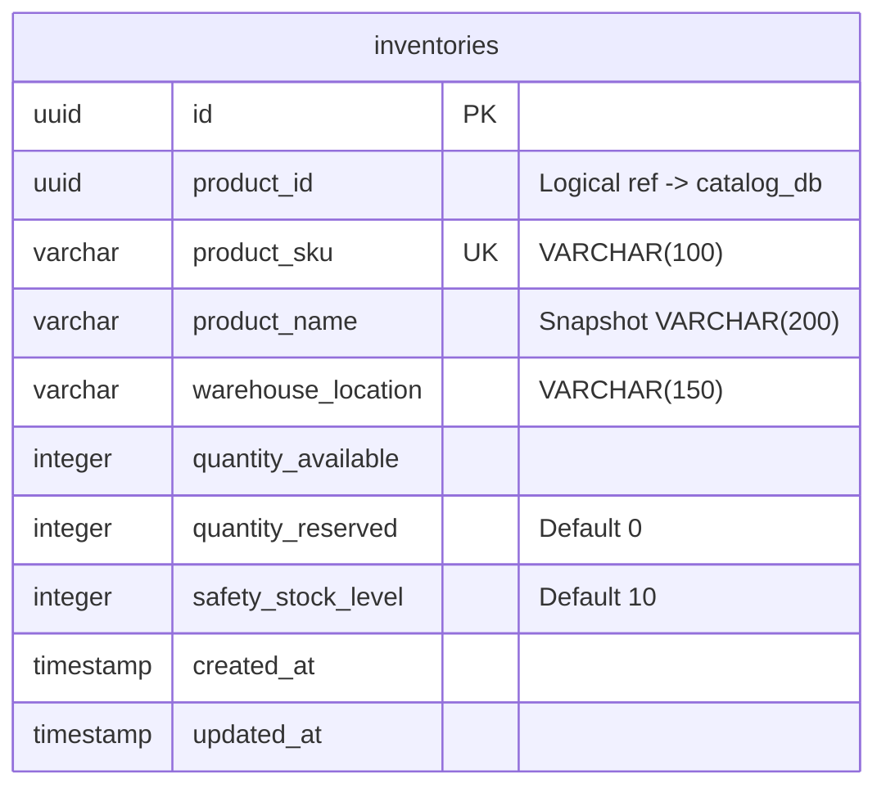

# 📋 Inventory Service Database Schema (`inventory_db`)

Database table structure, unique constraints, and cross-service product references for `inventory-service`.

| Attribute | Value |
| :--- | :--- |
| **Microservice** | `inventory-service` (`:8084`) |
| **PostgreSQL DB** | `inventory_db` (`:5438`, `spring.jpa.hibernate.ddl-auto: update`) |
| **Schema Management** | JPA / Hibernate entity definitions (no Flyway SQL scripts in `database\migrations\` yet) |
| **Table Count** | `1` table (`inventories`) |

---

## 1. 📊 Database Relationship Diagrams

### Terminal-Safe Overview (Unicode Box Art)

```text
┌────────────────────────────────────────────────────────┐
│ inventory_db (:5438) - 1 Table (Cross-DB UUID Ref)     │
├────────────────────────────────────────────────────────┤
│ inventories (id PK, product_id, product_sku UK,        │
│              product_name, warehouse_location,         │
│              quantity_available, quantity_reserved,    │
│              safety_stock_level)                       │
│   │                                                    │
│   └── Cross-DB Logical Ref (No SQL FK):                │
│        product_id / product_sku -> catalog_db.PRODUCTS │
└────────────────────────────────────────────────────────┘
```

### Entity-Relationship Diagram (Mermaid `erDiagram`)



---

## 2. 🔗 Constraints, Derived Status & Cross-Service References

### Intra-DB Constraints
* No internal SQL foreign keys exist (`inventories` is the sole table in `inventory_db`).
* `inventories.id`: UUID primary key generated by Hibernate (`GenerationType.UUID`).
* `inventories.product_sku`: Unique (`unique = true`, `nullable = false`, `length = 100`).
* Derived `StockStatus` (computed dynamically in `Inventory.getStockStatus()`, not stored as a DB column):
  * `OUT_OF_STOCK`: `quantityAvailable == null || quantityAvailable <= 0`
  * `LOW_STOCK`: `safetyStockLevel != null && quantityAvailable <= safetyStockLevel`
  * `IN_STOCK`: `quantityAvailable > safetyStockLevel`

### Cross-Service Logical References (No SQL Foreign Keys)
| Column in `inventory_db` | Logical Target Module & Table | Purpose |
| :--- | :--- | :--- |
| `inventories.product_id`, `product_sku` | `catalog-service` (`catalog_db.PRODUCTS`) | Maps warehouse stock record 1:1 to its master catalog product without cross-database joins; `product_name` is cached locally for inventory reporting |

---

## 3. 🔗 Verified Source References

* `backend\inventory-service\src\main\resources\application.yaml` (lines 8–21) — `inventory_db` datasource (`:5438`) and `ddl-auto: update`.
* `backend\inventory-service\src\main\java\com\coding\model\BaseEntity.java` (lines 12–25) — Shared `created_at` and `updated_at` timestamps.
* `backend\inventory-service\src\main\java\com\coding\model\Inventory.java` (lines 17–64) — `inventories` entity and `getStockStatus()` logic.
* `backend\inventory-service\src\main\java\com\coding\model\StockStatus.java` (lines 3–7) — `IN_STOCK`, `LOW_STOCK`, `OUT_OF_STOCK` enum.
