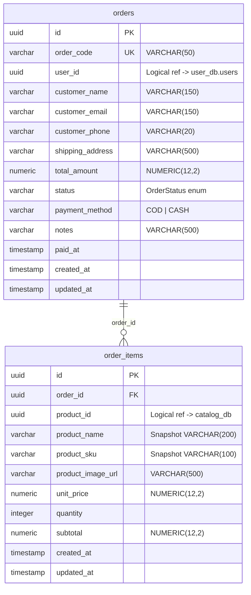

# 🛒 Order Service Database Schema (`order_db`)

Database table structure, foreign keys, JPA relationships, and cross-service UUID references for `order-service`.

| Attribute | Value |
| :--- | :--- |
| **Microservice** | `order-service` (`:8083`) |
| **PostgreSQL DB** | `order_db` (`:5437`, `spring.jpa.hibernate.ddl-auto: update`) |
| **Schema Management** | JPA / Hibernate entity definitions (no Flyway SQL scripts in `database\migrations\` yet) |
| **Table Count** | `2` tables (`orders`, `order_items`) |

---

## 1. 📊 Database Relationship Diagrams

### Terminal-Safe Overview (Unicode Box Art)

```text
┌────────────────────────────────────────────────────────┐
│ order_db (:5437) - 2 Tables (SQL FK + Cross-DB UUIDs)  │
├────────────────────────────────────────────────────────┤
│ orders (id PK, order_code UK, user_id, total_amount,   │
│         status, payment_method, paid_at)               │
│   │                                                    │
│   ├── 1:N (@BatchSize 25) ──► order_items (order_id FK,│
│   │                             product_id, unit_price)│
│   ▼                                                    │
│ Cross-DB Logical UUIDs (No SQL FKs):                   │
│  orders.user_id         -> user_db.users.id            │
│  order_items.product_id -> catalog_db.PRODUCTS.id      │
└────────────────────────────────────────────────────────┘
```

### Entity-Relationship Diagram (Mermaid `erDiagram`)



---

## 2. 🔗 Intra-DB Foreign Keys, Constraints & Cross-Service Links

### Intra-DB SQL Foreign Key
| Source Table & Column | Target Table & Column | Cardinality | JPA / Performance Notes |
| :--- | :--- | :--- | :--- |
| `order_items.order_id` | `orders.id` | `1:N` / `N:1` | `@OneToMany(mappedBy = "order", cascade = ALL, orphanRemoval = true)` + `@BatchSize(size = 25)` in `Order.java`; `@ManyToOne(fetch = LAZY)` + `@JsonIgnore` in `OrderItem.java` |

### Cross-Service Logical References (No SQL Foreign Keys)
| Column in `order_db` | Logical Target Module & Table | Purpose / Snapshot Strategy |
| :--- | :--- | :--- |
| `orders.user_id` | `user-service` (`user_db.users.id`) | Associates order with authenticated customer UUID (`nullable` for guest/COD creation if omitted) |
| `order_items.product_id`, `product_sku` | `catalog-service` (`catalog_db.PRODUCTS`) | Identifies ordered product; `product_name`, `product_sku`, `product_image_url`, and `unit_price` are stored as historical snapshots so price edits in `catalog_db` do not mutate past orders |

### Constraints & Enum Values
* Unique constraint: `orders.order_code` (`unique = true`, `length = 50`).
* `OrderStatus`: `PENDING_PAYMENT`, `PAID`, `PROCESSING`, `SHIPPED`, `DELIVERED`, `CANCELLED` (default `PROCESSING`).
* `PaymentMethod`: `COD`, `CASH` (default `COD`).

---

## 3. 🔗 Verified Source References

* `backend\order-service\src\main\resources\application.yaml` (lines 8–21) — `order_db` datasource (`:5437`) and `ddl-auto: update`.
* `backend\order-service\src\main\java\com\coding\model\BaseEntity.java` (lines 12–25) — Shared `created_at` and `updated_at` timestamps.
* `backend\order-service\src\main\java\com\coding\model\Order.java` (lines 26–87) — `orders` entity and `@BatchSize(size = 25)` line-item mapping.
* `backend\order-service\src\main\java\com\coding\model\OrderItem.java` (lines 22–62) — `order_items` entity and `order_id` foreign key.
* `backend\order-service\src\main\java\com\coding\model\OrderStatus.java` (lines 3–10) — Order lifecycle status enum.
* `backend\order-service\src\main\java\com\coding\model\PaymentMethod.java` (lines 3–6) — `COD` and `CASH` enum.
