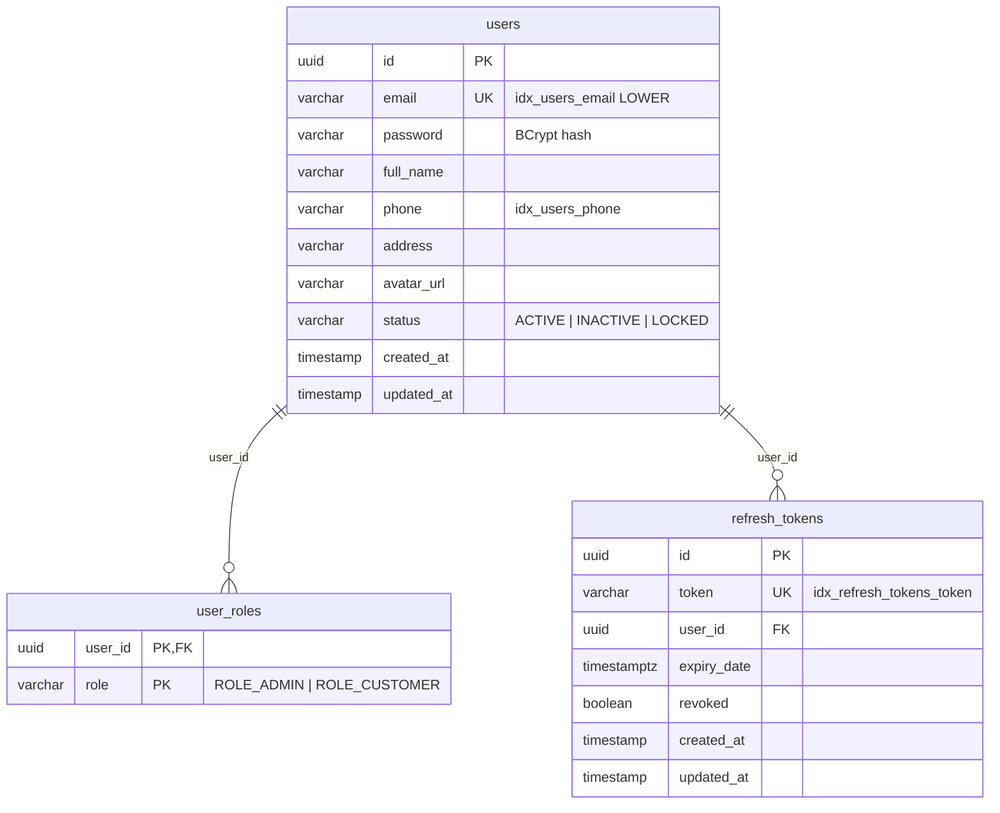

# 👤 User Service Database Schema (`user_db`)

Database table structure, foreign keys, JPA relationships, and indexes for `user-service`.

| Attribute | Value |
| :--- | :--- |
| **Microservice** | `user-service` (`:8082`) |
| **PostgreSQL DB** | `user_db` (`:5436`, `spring.jpa.hibernate.ddl-auto: update`) |
| **Flyway Migrations** | `database\migrations\user\V1__init_user_schema.sql`, `V2__seed_admin_user.sql` |
| **Table Count** | `3` tables (`users`, `user_roles`, `refresh_tokens`) |

---

## 1. 📊 Database Relationship Diagrams

### Terminal-Safe Overview (Unicode Box Art)

```text
┌────────────────────────────────────────────────────────┐
│ user_db (:5436) - 3 Tables (SQL FKs)                   │
├────────────────────────────────────────────────────────┤
│ users (id PK, email UK, password, full_name, status)   │
│   │                                                    │
│   ├── 1:N (EAGER) ──► user_roles (user_id PK/FK, role) │
│   │                                                    │
│   └── 1:N (LAZY)  ──► refresh_tokens (token UK,        │
│                                       user_id FK)      │
└────────────────────────────────────────────────────────┘
```

### Entity-Relationship Diagram (Mermaid `erDiagram`)



---

## 2. 🔗 Intra-DB Foreign Keys, Constraints & JPA Mapping

| Source Table & Column | Target Table & Column | Cardinality | SQL `ON DELETE` | JPA / Security Notes |
| :--- | :--- | :--- | :--- | :--- |
| `user_roles.user_id` | `users.id` | `1:N` | `CASCADE` | `@ElementCollection(fetch = FetchType.EAGER)` in `User.java`; composite PK `(user_id, role)` |
| `refresh_tokens.user_id` | `users.id` | `1:N` | `CASCADE` | `@ManyToOne(fetch = FetchType.LAZY)` in `RefreshToken.java` |

### Cross-Service Logical References (No SQL Foreign Keys)
* `user_db` holds **no** outgoing references to other microservices.
* `order_db.orders.user_id` logically references `users.id` (and JWT tokens carry `users.id` as `subject` plus `roles` claims).

### Unique & Secondary Indexes
* `idx_users_email`: Unique index on `users (LOWER(email))`; note `User.java` also sets `unique = true` on `email`.
* `idx_users_phone`: Index on `users (phone)`.
* `idx_user_roles_user_id`: Index on `user_roles (user_id)`.
* `idx_refresh_tokens_token`: Unique index on `refresh_tokens (token)`.
* `idx_refresh_tokens_user_id`: Index on `refresh_tokens (user_id)`.

---

## 3. 🔗 Verified Source References

* `database\migrations\user\V1__init_user_schema.sql` (lines 1–41) — DDL for `users`, `user_roles`, and `refresh_tokens`.
* `database\migrations\user\V2__seed_admin_user.sql` (lines 1–39) — Seeded admin & customer users using `pgcrypto` `crypt(..., gen_salt('bf', 10))`.
* `backend\user-service\src\main\resources\application.yaml` (lines 8–22) — `user_db` datasource (`:5436`) and `ddl-auto: update`.
* `backend\user-service\src\main\java\com\coding\model\BaseEntity.java` (lines 12–31) — Shared `created_at` and `updated_at` timestamps.
* `backend\user-service\src\main\java\com\coding\model\User.java` (lines 25–68) — `users` entity and eager `user_roles` mapping.
* `backend\user-service\src\main\java\com\coding\model\UserStatus.java` (lines 3–7) — `ACTIVE`, `INACTIVE`, `LOCKED` enum values.
* `backend\user-service\src\main\java\com\coding\model\RefreshToken.java` (lines 21–49) — `refresh_tokens` entity.
